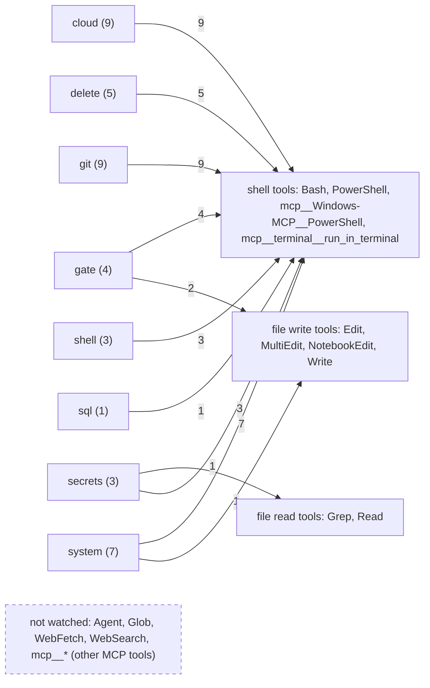

# EmberArmor security graph

Generated by `python tools/security_graph/build_security_graph.py`. Do not edit by hand: a test fails
when this file or security_graph.json no longer matches the rules and corpus.

## At a glance

- Rules: 41 (ask 38, deny 2, warn 1)
- Areas: cloud 9, delete 5, gate 4, git 9, secrets 3, shell 3, sql 1, system 7
- Corpus: 688 must-flag, 635 must-not-flag entries
- Tools the rules can reach: Bash, Edit, Grep, MultiEdit, NotebookEdit, PowerShell, Read, Write, mcp__Windows-MCP__PowerShell, mcp__terminal__run_in_terminal
- Tools no rule looks at: Agent, Glob, WebFetch, WebSearch, mcp__* (other MCP tools)

## Map: areas to the kinds of tool their rules reach

Edge labels count rules. The dashed box is what no rule looks at.

## Gaps worth a look

Each list is generated. Empty lists mean no gap of that kind.

### Tools no rule looks at

The gate parses facts only for shell and file tools. A rule can still watch
these with an `arg` or `text_regex` predicate; none does today.

- Agent
- Glob
- WebFetch
- WebSearch
- mcp__* (other MCP tools)

### Rules with no corpus case that fires them

- none

### Rules that reach a file tool but have no file-tool case

The rule can fire on these tools (it watches a path operation they do),
but every must-flag case for it is a shell command.

- none

### Rules with no PowerShell case

No must-flag case runs the rule through PowerShell. Some of these watch
Unix-only programs, where that is expected.

- none

### Program rules with no near-miss case

No must-not-flag entry runs a program the rule watches with the same
subcommand, so nothing tests that a harmless use of it passes.

- none

## Rules

Watches: programs, path operations and shell signals the rule looks at.
Cases: must-flag entries the gate really flags with this rule, by tool.
Shells: of those cases, how many parse to a command in each shell.
Near: must-not-flag entries that run a watched program and subcommand.
Tests: test files that name the rule id (besides the corpus).
Fixed: no exception can drop the rule.

### cloud

| Rule | Effect | Watches | Cases | Shells | Near | Tests | Fixed |
|---|---|---|---|---|---|---|---|
| builtin.cloud.aws-s3-delete | ask | aws | Bash 4, PowerShell 1 | bash 4, powershell 1 | 7 | 0 |  |
| builtin.cloud.docker-prune | ask | docker, podman | Bash 3, PowerShell 1 | bash 3, powershell 1 | 4 | 0 |  |
| builtin.cloud.docker-volume-rm | ask | docker, docker-compose, podman | Bash 5, PowerShell 1 | bash 5, powershell 1 | 5 | 0 |  |
| builtin.cloud.gh-repo-delete | ask | gh | Bash 1, PowerShell 1 | bash 1, powershell 1 | 4 | 0 |  |
| builtin.cloud.kubectl-delete | ask | kubectl, oc | Bash 5, PowerShell 1 | bash 5, powershell 1 | 1 | 0 |  |
| builtin.cloud.npm-unpublish | ask | npm, pnpm | Bash 1, PowerShell 2 | bash 1, powershell 2 | 3 | 0 |  |
| builtin.cloud.resource-delete | ask | aws, az, cdk, cdktf, fly +8 | Bash 14, PowerShell 1 | bash 14, powershell 1 | 12 | 0 |  |
| builtin.cloud.terraform-destroy | ask | terraform, terragrunt, tofu | Bash 7, PowerShell 2 | bash 7, powershell 2 | 4 | 0 |  |
| builtin.cloud.vercel-remove | ask | vc, vercel | Bash 10, PowerShell 3 | bash 10, powershell 3 | 3 | 0 |  |

### delete

| Rule | Effect | Watches | Cases | Shells | Near | Tests | Fixed |
|---|---|---|---|---|---|---|---|
| builtin.delete.git-dir | deny | path:delete | Bash 6, PowerShell 2 | bash 6, powershell 2 | - | 2 | yes |
| builtin.delete.home-wildcard | ask | path:delete | Bash 4, PowerShell 4 | bash 4, cmd 1, powershell 4 | - | 0 |  |
| builtin.delete.mirror | ask | robocopy, rsync | Bash 3, PowerShell 2 | bash 3, powershell 2 | 5 | 1 |  |
| builtin.delete.protected | deny | path:delete | Bash 30, PowerShell 20 | bash 30, cmd 1, powershell 20 | - | 10 | yes |
| builtin.delete.recursive | ask | path:delete | Bash 118, PowerShell 62 | bash 121, cmd 9, powershell 62 | - | 6 |  |

### gate

| Rule | Effect | Watches | Cases | Shells | Near | Tests | Fixed |
|---|---|---|---|---|---|---|---|
| builtin.gate.environment | ask | assigns:EMBER_GATE_MODE,EMBER_LEDGER,EMBER_HOME,EMBER_GATE_BUILTIN,EMBER_GATE_REMIND_INTERVAL | Bash 9, PowerShell 6 | bash 8, cmd 1, powershell 4 | - | 2 | yes |
| builtin.gate.files | ask | path:delete, path:write | Bash 10, Edit 2, PowerShell 6, Write 2 | bash 10, powershell 6 | - | 2 | yes |
| builtin.gate.host-settings | ask | path:delete, path:write | Bash 3, Edit 1, MultiEdit 1, PowerShell 2, Write 1 | bash 3, powershell 2 | - | 1 | yes |
| builtin.gate.rules | ask | ember-gate, py, python, python3 | Bash 7, PowerShell 4 | bash 7, powershell 4 | 19 | 1 | yes |

### git

| Rule | Effect | Watches | Cases | Shells | Near | Tests | Fixed |
|---|---|---|---|---|---|---|---|
| builtin.git.branch-force-delete | ask | git | Bash 4, PowerShell 1 | bash 4, powershell 1 | 4 | 0 |  |
| builtin.git.clean | ask | git | Bash 9, PowerShell 2 | bash 9, powershell 2 | 3 | 2 |  |
| builtin.git.discard-worktree | ask | git | Bash 13, PowerShell 2 | bash 13, powershell 2 | 14 | 0 |  |
| builtin.git.force-push | ask | git | Bash 12, PowerShell 5 | bash 13, powershell 4 | 13 | 13 |  |
| builtin.git.force-push-lease | warn | git | Bash 2, PowerShell 1 | bash 2, powershell 1 | 13 | 1 |  |
| builtin.git.history-prune | ask | git | Bash 3, PowerShell 2 | bash 3, powershell 2 | 5 | 0 |  |
| builtin.git.remote-delete | ask | git | Bash 3, PowerShell 1 | bash 3, powershell 1 | 13 | 0 |  |
| builtin.git.reset-hard | ask | git | Bash 34, PowerShell 26 | bash 35, cmd 8, powershell 25 | 3 | 3 |  |
| builtin.git.stash-drop | ask | git | Bash 2, PowerShell 2 | bash 2, powershell 2 | 5 | 0 |  |

### secrets

| Rule | Effect | Watches | Cases | Shells | Near | Tests | Fixed |
|---|---|---|---|---|---|---|---|
| builtin.secrets.environment | ask | declare, env, export, get-childitem, get-item +3 | Bash 7, PowerShell 5 | bash 7, cmd 1, powershell 5 | 21 | 0 |  |
| builtin.secrets.read | ask | path:read | Bash 65, Grep 4, PowerShell 21, Read 3 | bash 65, cmd 1, powershell 21 | - | 4 |  |
| builtin.secrets.variable | ask | echo, get-childitem, get-item, out-host, printenv +8 | Bash 6, PowerShell 5 | bash 6, cmd 1, powershell 3 | 52 | 0 |  |

### shell

| Rule | Effect | Watches | Cases | Shells | Near | Tests | Fixed |
|---|---|---|---|---|---|---|---|
| builtin.shell.download-pipe | ask | dynamic:download_pipe | Bash 11, PowerShell 5 | bash 11, powershell 6 | - | 3 |  |
| builtin.shell.unknown-directory | ask | unknown-directory | Bash 1, PowerShell 1 | bash 1, powershell 1 | - | 4 |  |
| builtin.shell.unreadable | ask | dynamic:parse_error,encoded_command | Bash 4, PowerShell 3 | bash 3, powershell 2 | - | 2 |  |

### sql

| Rule | Effect | Watches | Cases | Shells | Near | Tests | Fixed |
|---|---|---|---|---|---|---|---|
| builtin.sql.destructive | ask | bq, clickhouse-client, cockroach, duckdb, invoke-sqlcmd +12 | Bash 20, PowerShell 3 | bash 20, powershell 3 | 24 | 0 |  |

### system

| Rule | Effect | Watches | Cases | Shells | Near | Tests | Fixed |
|---|---|---|---|---|---|---|---|
| builtin.system.antivirus-off | ask | aa-teardown, add-mppreference, csrutil, net, sc +6 | Bash 7, PowerShell 11 | bash 7, powershell 11 | 6 | 0 |  |
| builtin.system.disk | ask | bcdedit, blkdiscard, clear-disk, dd, diskpart +25 | Bash 6, PowerShell 9 | bash 6, powershell 9 | 7 | 0 |  |
| builtin.system.firewall-off | ask | ip6tables, iptables, netsh, nft, pfctl +4 | Bash 12, PowerShell 6 | bash 12, powershell 6 | 8 | 0 |  |
| builtin.system.login-files | ask | path:delete, path:write | Bash 4, Edit 2, PowerShell 2, Write 4 | bash 4, powershell 2 | - | 0 |  |
| builtin.system.registry-defences | ask | new-item, new-itemproperty, reg, set-itemproperty | Bash 1, PowerShell 3 | bash 1, powershell 3 | 3 | 0 |  |
| builtin.system.registry-delete | ask | clear-item, clear-itemproperty, reg, remove-item, remove-itemproperty | Bash 3, PowerShell 6 | bash 3, powershell 6 | 35 | 0 |  |
| builtin.system.trust-root-cert | ask | caddy, certutil, dotnet, import-certificate, import-pfxcertificate +7 | Bash 8, PowerShell 7 | bash 8, powershell 7 | 9 | 0 |  |

## Overlaps

Rule pairs that fire together on the same must-flag case.

- builtin.delete.protected + builtin.delete.recursive: 50
- builtin.delete.git-dir + builtin.delete.recursive: 8
- builtin.delete.recursive + builtin.gate.files: 1
